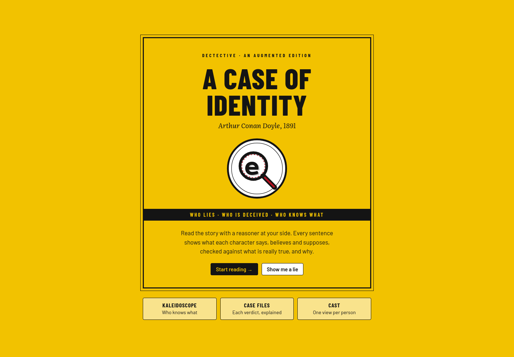

# A Case of Identity — edizione digitale aumentata (DEC)

Edizione digitale del racconto di Conan Doyle, testo integrale, con le inferenze di DEC rese visibili frase per frase. Lo scopo è mostrare che DEC sa spiegare in modo comprensibile **menzogne, delusioni ed errori in buona fede**: il testo li segnala con sottolineature e icone, e ogni frase apre un **caleidoscopio**. Al centro c'è Reality; attorno, una fetta per persona, con ciò che dice, crede, conclude o suppone. Tutto è calcolato dalle materializzazioni DEC già prodotte nell'audit. Comprende anche:

- i **case file**: spiegazioni passo per passo, generate automaticamente, di ogni verdetto;
- un **endpoint SPARQL** pubblico, con 27 coppie linguaggio naturale ↔ SPARQL;
- **Deductions**: cosa DEC può concludere a ogni indizio della storia, rispetto alle conclusioni finali.

Interfaccia in inglese. Il linguaggio è piano: il termine DEC compare al passaggio del mouse e nella pagina *How it works*. Grafica: superfici bianche su fondo neutro, testo nero, giallo usato come accento (marchio, Reality, evidenziazioni, stati attivi), rosso per menzogne, delusioni e conflitti. La copertina è l'unica pagina tutta gialla. C'è anche un tema scuro.



## Avvio

Richiede Node ≥ 22.18. Il server usa il type stripping nativo, senza passo di compilazione.

```bash
cd edition
npm install            # dipendenze di server e web (workspaces)
npm run build          # compila la SPA in web/dist
npm start              # http://localhost:4410  (endpoint: http://localhost:4410/sparql)
```

| Comando | Effetto |
|---|---|
| `PORT=8080 npm start` | porta diversa; anche `SPARQL_TIMEOUT_MS`, `SPARQL_MAX_ROWS` |
| `npm run dev` | server con `--watch` + Vite su :5173 (proxy di `/api`, `/sparql` e `/portraits` verso :4410) |
| `npm test` | 89 test del server (vitest + supertest) + 22 test di contrasto WCAG dei token grafici |
| `npm run typecheck` | `tsc --noEmit` su entrambi i workspace |
| `npm run build:data` | rigenera `edition/data/` dagli artefatti dell'audit (Python della `.venv` del progetto) |

I dati in `edition/data/` sono già generati. `build:data` serve solo se cambiano gli artefatti a monte. La build è deterministica: due esecuzioni producono file con SHA-256 identico, registrato in `data/build_info.json`.

## Pagine

| Percorso | Contenuto |
|---|---|
| `/` | copertina |
| `/read` | testo integrale. Indice semplice (parti e pagina); barra fissa sopra il testo che fa da legenda e da interruttore dei segni: **Lie**, **Delusion**, **Honest mistake** (rosso), **Names & identity**, **Reasoning**, **Case files**. Una frase è cliccabile solo se il modello le lega almeno una proposizione: il solo allineamento KGRC non basta più. Il pannello della frase mostra prima i verdetti, poi le affermazioni della frase, il caleidoscopio e "who holds what"; diagramma, case file e confronto KGRC sono ripiegati. Tastiera: ↑/↓, Invio, Esc. |
| `/kaleidoscope` | "Who knows what": fatti × Reality × persone (ritratti nelle intestazioni). Filtri: dove i punti di vista si scontrano / menzogne e delusioni / tutto |
| `/kaleidoscope/:frase` | il caleidoscopio grande di una frase, con chi sostiene cosa |
| `/deductions` | **Deductions**: cosa DEC può concludere a ogni indizio della storia. In alto, la barra della storia: quante conclusioni ci sono finora e dove una menzogna o una delusione diventa rilevabile. Sotto, tre schede: *New here* (le conclusioni nuove, ciascuna con regola e premesse collegate alla pagina), *So far* e *Compared with the end* (cosa manca, e quali fatti cambieranno). Si naviga con clic, trascinamento, ←/→, i salti rapidi o `?at=<frase>` |
| `/dossiers`, `/dossiers/:id` | 13 case file come cartelline. Timbro con una o due parole e un sottotitolo (LIE, DELUSION, HONEST MISTAKE, FALSE ALARM, SAME PERSON, INFERRED, REFUTED, CONFIRMED, REJECTED, ONLY IF…, PREDICTED, A MASK); passi numerati con chi li produce (**DEC**, *Edition*, KGRC) e la query ripiegata sotto ogni passo; note e assunzioni; passi del testo; diagramma |
| `/cast`, `/cast/:persona` | ritratti; per persona: punti di vista, menzogne e delusioni, cosa dice / crede / conclude / suppone (ciascuno confrontato con Reality), nomi (solo se ambigui), argomenti su cui tace (ripiegati) |
| `/worlds` | mappa fissa: Reality al centro, le persone sempre negli stessi posti, linee solo per i conflitti segnalati da DEC contro Reality (conflitto / solo se… / falso allarme); sotto, ogni segnalazione DEC riesaminata |
| `/lab` | SPARQL Lab: domande d'esempio, editor, risultati, download CSV/JSON; endpoint e grafi in un pannello ripiegato |
| `/method` | *How it works*: glossario parola dell'edizione → termine DEC, verdetti, bug di DEC, lettura senza spoiler, provenienza, limiti, licenze |

**Lettura senza spoiler.** Dal pulsante con l'occhio nell'intestazione si sceglie fin dove si è letto:

| Tappa | Nome mostrato | Fine |
|---|---|---|
| C1 | Mary's visit | p. 4 |
| C2 | The clues | p. 6 |
| C3 | The typewriter | p. 7 |
| C4 | The unmasking | p. 8 |
| — | The whole story | — |

Il testo oltre la tappa è sigillato e tutte le viste usano gli snapshot, con IRI neutri. La fine di ogni tappa è segnata anche nel testo, con il pulsante "Pause here, no spoilers". Tappa e tema stanno nell'URL (`?mode=C2`, `?theme=noir`).

**Deduzioni nel Reader.**
- Nella barra dei segni c'è il pulsante "New deductions": accende un "⚙ +n" dopo ogni frase da cui DEC può trarre conclusioni nuove.
- Sotto l'indice, "DEC so far" segue la posizione di lettura.
- Nel pannello della frase, "What DEC can now conclude".

**Ritratti.** Gli 8 ritratti a matita stanno in `portraits/<id>.png` (`mary`, `windibank`, `hosmer`, `holmes`, `watson`, `mother`, `reader`, `whatif`). `npm run build:portraits` ne ricava le versioni web in `portraits/web/`: l'ovale intero per Cast e schede, il ritaglio sul volto per i cerchi. Il server li elenca in `/api/meta` senza bisogno di ricompilare. Per un ritratto mancante compare un segnaposto a matita. Prompt e ritagli: [portraits/README.md](portraits/README.md).

## Vocabolario: parola dell'edizione → termine DEC

| Nell'interfaccia | In DEC |
|---|---|
| Reality | mondo `reality` (fatti narrati + soluzione di Holmes accettata) |
| says / believes / concludes / supposes | mondo verbatim / doxastic / epistemic / conjectural governato dalla persona |
| Shared background | mondo `shared` (schema e assiomi) |
| stated / inherited / inferred by DEC | asserted / received (permeazione) / derived |
| ruled out / ruled out, if… / silent | contradicted / contradicted assuming closure / not determined |
| The reader | `st:solver`, lettore simulato (solo nella lettura senza spoiler) |
| Editors' what-if | `st:analyst`, ipotesi di controllo non presente nel testo |
| Hosmer Angel (nella storia intera) | persona fusa in Windibank quando Reality conosce l'identità ("alias Hosmer") |

## Come vengono calcolati stati, posizioni e verdetti

Per una proposizione *p* e un mondo *W*, con M(W) la vista materializzata da DEC e A(W) il contenuto asserito, lo stato di *p* in *W* è il primo che si applica:

1. **stated** (asserted): *p* ∈ A(W).
2. **inherited** (received): *p* ∈ M(W) \ A(W) e *p* è in un mondo che DEC fa permeare in W. Viene indicata la sorgente.
3. **inferred by DEC** (derived): *p* è in M(W) per altra via. Viene riconosciuto lo schema della regola: sostituzione per identità, simmetria, gerarchia di classi, proprietà inverse-funzionale.
4. **ruled out** (contradicted): W contiene qualcosa di incompatibile con *p* secondo un `owl:disjointWith` dichiarato.
5. **ruled out, if…** (contradicted assuming closure): W ha un valore **diverso** per un predicato dichiarato chiuso. È la semantica corretta, non quella difettosa di DEC, e viene mostrato come assunzione.
6. **silent** (not determined): nessuno dei casi precedenti. Non viene mai presentato come "falso".

**Punti di vista** (`server/src/rules/viewpoints.ts`). Per ogni proposizione si calcolano due cose:
- il valore in Reality: vero, falso, falso se…, non detto;
- per ogni persona, sempre nello stesso ordine, le sue posizioni (*says* / *believes* / *concludes* / *supposes*, ✓ o ✕). Valgono anche le posizioni sotto un altro nome, quando l'identità è nota.

Ciò che un'ipotesi si limita a ereditare da Reality non conta come posizione propria. Le persone senza posizione risultano "silent".

**Diagnosi.**

| Diagnosi | Regola |
|---|---|
| **Lie** | la persona dice *p* e una sua credenza lo esclude (schema T05a) |
| **Delusion** | la persona crede *p* e Reality lo esclude |
| **Honest mistake** | la persona dice e crede *p*, ma Reality lo esclude (T05b) |

La diagnosi viene segnata nel testo solo dove è ancorato il mondo che la porta. La menzogna di Windibank sulla scomparsa è segnata in P067.S01, dove viene detta, e non nelle frasi in cui Mary ne ripete il contenuto: lì il segno è la delusione di Mary.

**Segnalazioni DEC riesaminate.** I verdetti `dec:disagreesWith` / `dec:delusionalWorld` vengono controllati coppia per coppia:

| Nell'interfaccia | Significato |
|---|---|
| Conflict | viola una disgiunzione dichiarata |
| Only if… | incompatibile solo se si assume un valore unico per soggetto |
| False alarm | prodotto solo dal bug `closedFor`, quando i due mondi hanno lo **stesso** valore (es. `windibank_beliefs` vs Reality; `w22`/`w23` alla tappa C3) |

## Deduzioni nel tempo (`/deductions`)

Ogni **indizio** è una frase che aggiunge qualcosa al modello gold: ce ne sono 37. Per ciascun indizio, DEC gira una volta su tutto ciò che il lettore ha letto fin lì. Lo fa `scripts/run_edition_timeline.py` (Java + runner dell'audit, circa 3 minuti):

```bash
python3 -I scripts/run_edition_timeline.py .     # 38 esecuzioni DEC (37 indizi + base con il solo schema)
npm run build:data                               # ricava edition/data/timeline.json e il grafo edition/timeline
```

**Regole di ingresso** (`annotations/timeline_overrides.json` per le correzioni; ogni decisione è in `prototype/results/timeline/availability.csv`):
- un fatto entra alla prima frase che lo sostiene;
- un punto di vista entra, insieme alla dichiarazione di chi lo crede o lo conclude, quando sono stati letti sia il suo passo sia il suo primo contenuto, entro la sua tappa;
- lo schema c'è dall'inizio;
- controllo dei conflitti e `closedFor` non vengono usati, così ogni esecuzione richiede secondi e non minuti.

**Cosa ne risulta:**
- **Monotonia verificata.** La materializzazione cresce a ogni indizio e non si perde nulla. Quindi una tripla vale all'indizio k se e solo se il suo primo indizio è ≤ k.
- **Stato finale.** Contiene tutto il contenuto delle viste gold dell'edizione.
- **Conclusioni.** 60 a livello di trama, più 667 minori (gerarchia di classi, contabilità CIDOC CRM). Ognuna ha una regola riconosciuta: identità, simmetria, tratto identificante, inversa, sottoproprietà, dominio/codominio, oppure "accettata in Reality" dalla soluzione di Holmes. Ognuna appare esattamente quando arriva la sua ultima premessa.
- **Verdetti indizio per indizio.** Lie, Delusion e Honest mistake si calcolano con le stesse regole delle altre pagine. L'identità Hosmer = Windibank conta solo da quando è in Reality (P126.S11). Gli 8 verdetti diventano tutti rilevabili fra P126.S11 e P128.S10. Esempio: la menzogna di Windibank sulla scomparsa, detta a P067.S01, diventa rilevabile solo a P128.S10, quando le sue credenze dicono che fu volontaria.
- **Metriche.** Tempo, triple asserite e materializzate per ogni esecuzione, con le medie (4,7 s per esecuzione, 13.509 triple materializzate): `prototype/results/timeline/metrics.json`.
- **Senza spoiler.** L'API si ferma alla tappa scelta e oltre restituisce solo conteggi.

## Endpoint SPARQL

`GET /sparql?query=…`, `POST` form-urlencoded, `POST application/sparql-query`. Risultati JSON (predefinito), CSV, TSV, XML (`?format=` o header `Accept`); CONSTRUCT/DESCRIBE in Turtle o N-Triples. L'endpoint è in sola lettura (Update → 403), con CORS aperto, timeout di 10 s (la query bloccata viene interrotta terminando il worker) e un limite di 10.000 righe. Un browser che apre `/sparql` senza query viene reindirizzato al Lab.

| Grafo | Contenuto |
|---|---|
| grafo di default | realtà DEC del dataset retrospettivo (le query dell'audit girano invariate) |
| `http://w3id.org/conjectures/reality` | la stessa realtà, come grafo con nome |
| `http://example.org/dectective/world/<w>` | vista DEC del mondo `w` (gold) |
| `http://example.org/dectective/asserted/<w>` | contenuto asserito (`reality` = fatti narrati, `shared` = schema e assiomi) |
| `http://example.org/dectective/snapshot/<Ck>/<w>` | vista DEC al checkpoint Ck |
| `http://example.org/dectective/snapshot-asserted/<Ck>/<w>` | asserito al checkpoint Ck |
| `http://example.org/dectective/edition/text` | sezioni, paragrafi, frasi, parlanti, pagine |
| `http://example.org/dectective/edition/annotation` | proposizioni, moduli, mondi, unità di allineamento, collegamenti KGRC |
| `http://example.org/dectective/edition/runs` | esecuzioni DEC e loro diagnosi |
| `http://kgc.knowledge-graph.jp/data/ACaseOfIdentity` | grafo KGRC originale, invariato (CC BY 4.0) |

Le 27 domande d'esempio sono in `annotations/examples.yaml`, in 8 categorie: testo, chi ha detto cosa, credenze, identità e nomi, disaccordi e delusione, checkpoint, confronto con KGRC, provenienza DEC. Ognuna è verificata da un test.

## Architettura

```
edition/
  annotations/   curati a mano: sections, speakers, agents, worlds, labels, triple_anchors, examples.yaml,
                 alignment_issues_en.json (resa inglese delle note di allineamento dell'audit)
  data/          generati da scripts/build_edition_data.py: edition.nq (116.239 quad), text.json, catalog.json,
                 runs.json, provenance.json, build_info.json
  server/        Express 5 + Oxigraph 0.5 (store SPARQL in memoria, ~0,3 s per caricare tutto)
    src/timeline.ts  Deductions: conclusioni per indizio con premesse, eventi (verdetti, valori di Reality), limite spoiler
    src/rules/       perspectives (stati per mondo), viewpoints (persone, Reality, diagnosi, segni per frase),
                     incompatibility (disgiunzioni, chiusure), derivation
    src/dossiers.ts  rilevamento + passi SPARQL + resa deterministica dei case file
    src/graph.ts     elementi del diagramma a colonne (persone → punti di vista → affermazioni → cose e idee)
    src/sparql/      protocollo SPARQL 1.1 in un worker thread con timeout
    src/regression.ts  riesegue le query dell'audit sullo store dell'edizione
    test/            vitest + supertest
  web/           React 19 + Vite 8 + react-router 8, Cytoscape (caricato solo quando serve), CodeMirror 6,
                 font self-hosted (@fontsource: Barlow, Barlow Condensed, Literata, Courier Prime, IBM Plex Mono),
                 vocabolario in src/vocab.ts, icone in src/components/Glyphs.tsx, token grafici in src/theme/tokens.ts
  portraits/     ritratti dei personaggi (PNG aggiunti a mano) e prompt per generarli
  docs/screenshots/
```

Un solo processo Express serve la SPA, l'API JSON (`/api/*`) e l'endpoint `/sparql`.

## Dati e provenienza

Nessuna materializzazione dell'audit è stata ricalcolata. L'edizione riusa:
- i 30 dump DEC delle query (esclusa l'ablazione T06c, che compare tra le esecuzioni ma non nelle viste);
- gli snapshot di realtà C1–C4 del controllo di leakage;
- i moduli asseriti, il testo segmentato, le unità di allineamento e l'allineamento automatico con KGRC;
- i risultati dei test.

Le viste di ogni mondo sono l'unione delle slice in cui compare. La provenienza per tripla (quale esecuzione l'ha prodotta) è in `data/provenance.json`.

**Esecuzioni DEC complementari** (`scripts/run_edition_complement.py`), segnate come `complement` nella provenienza e nella pagina Method:

| Esecuzione | Contenuto | Tempo DEC |
|---|---|---|
| `complement-gold` | i 6 mondi gold mai materializzati da un test: `holmes_mother`, `holmes_motive`, `holmes_same_machine`, `h_author_other`, `v_windibank_delighted`, `v_windibank_machine` | ~1 s |
| `complement-C1` … `complement-C4` | ciascun checkpoint intero, perché il lettore investigativo veda tutti i mondi di ogni checkpoint | 3,4 / 3,7 / 5,2 / 9,1 s |

Entrambe girano senza i flag di controllo dei conflitti (`checkInconsistencies`, `closedFor`), quindi senza diagnosi.

Le note di allineamento con KGRC dell'audit erano in italiano: l'edizione usa la resa inglese in `annotations/alignment_issues_en.json`. Le correzioni proposte restano solo in `data/text_graph_alignment.csv`.

## Verifica

- **Regola dei punti di vista sul primo viaggio in Francia come viaggio reale.** Asserito nel mondo di Mary. Contraddetto nella ricostruzione di Holmes (testimone asserito) e nella realtà (ricevuto dalla ricostruzione). Contraddetto nell'ipotesi di Watson solo tramite la realtà ereditata, quindi Watson non ha una posizione propria. Mary risulta *sincere but false*.
- **Punti di vista.** Il secondo viaggio come viaggio reale dà una delusione di Mary, Holmes che conclude il contrario e Watson silente. In P067.S01 c'è la menzogna di Windibank, con Hosmer fuso in lui ("alias Hosmer Angel"); in P059.S02 c'è la delusione di Mary e nessuna menzogna. Il "cashier" di Hosmer è una menzogna solo assumendo un'occupazione per persona.
- **Identità Hosmer = Windibank.** Presente nella realtà, assente dal mondo di Mary (opacità).
- **Insincerità di Windibank sulla sparizione.** Rilevata, anche come Hosmer tramite l'identità.
- **Case file.** Tutte le istanze attese vengono trovate, con i timbri attesi: Lie, Delusion, False alarm per "Windibank's beliefs" (bug `closedFor`). Almeno un passo è attribuito a DEC.
- **Regressione.** Le 29 query dell'audit (esclusa l'ablazione) rieseguite sullo store dell'edizione danno **27/29 risposte identiche** a quelle registrate da DEC. Le 2 differenze dipendono dall'unione delle slice e sono verificate esplicitamente in `server/test/regression.test.ts`:
  - T03b: le ipotesi del run complementare ereditano la realtà, dove il fidanzamento vale *de re*;
  - T06a: si aggiunge `windibank_beliefs`, delusional solo per l'artefatto `closedFor`.
- **Endpoint.** GET/POST, JSON/CSV, ASK/CONSTRUCT, sola lettura, errori, redirect, timeout con recupero. Ognuno dei 27 esempi gira e restituisce risultati.
- **Grafica.** Contrasto WCAG di ogni coppia testo/sfondo usata, in entrambi i temi, con test di guardia: niente testo bianco o rosso su giallo.
- **Interfaccia.** Controllata con Firefox headless in entrambi i temi, a 1440 px e a 400 px, nella storia intera e senza spoiler, con e senza un ritratto PNG. Le schermate sono in `docs/screenshots/`.

## Limiti

- Parlanti, ancore e proposizioni hanno un solo annotatore. Le credenze di Windibank derivano dalla ricostruzione di Holmes e sono marcate come attribuzione dei curatori.
- Due mondi mai messi nella stessa slice con controllo dei conflitti non hanno un verdetto DEC tra loro.
- Gli indizi di derivazione riconoscono schemi: sono spiegazioni, non una riesecuzione del ragionatore.
- L'allineamento automatico con KGRC è lessicale e non verificato. Le unità curate sono verificate a mano.

## Licenze

| Componente | Licenza |
|---|---|
| Testo (1891) | pubblico dominio |
| Grafo KGRC (SIG-SWO, JSAI) | CC BY 4.0, mostrato invariato nel proprio grafo con nome |
| DEC reasoner (fvitali/dec-reasoner, commit `e6775b39`) | MIT |
| Font (Barlow, Barlow Condensed, Literata, Courier Prime, IBM Plex Mono) | SIL OFL |

La grafica è originale, ispirata alle copertine dei gialli italiani degli anni Trenta, senza marchi editoriali.
